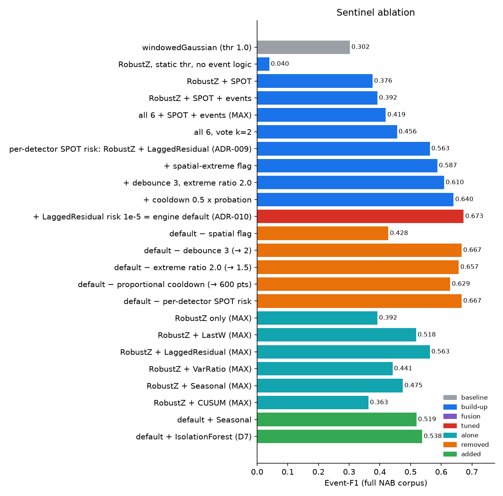

# Sentinel — Adaptive Streaming Time-Series Anomaly Detection

[]()
[]()
[-blue.svg)]()
[]()
[]()

> **Hackathon Challenge 2:** Online, lookahead-free streaming anomaly detection on the 58-file Numenta Anomaly Benchmark (NAB). Built with a causal multi-horizon detector ensemble, Extreme Value Theory (SPOT/EVT) dynamic thresholding, event lifecycle debounce & re-baselining, and structured operational explainability.

Sentinel reads one `(timestamp, value)` point at a time and returns, for every point:

| Field | Meaning |
|---|---|
| `score` | Fused anomaly score in [0, 1] (1 − tail probability under an EVT model) |
| `label` | `NORMAL` / `ANOMALOUS` |
| `is_event_start` | First point of a new anomaly event (what event-F1 and alarms count) |
| `evidence` | Structured diagnostic evidence — type, expected vs observed, deviation $\sigma$, fired detectors, natural-language explanation |

```json
{
  "type": "spike",
  "expected": 14093.6,
  "observed": 39197.0,
  "deviation_sigma": 7.9,
  "fired": ["LastW", "LaggedResidual", "Seasonal"],
  "top_detector": "LaggedResidual",
  "text": "Value 3.92e+04 is 7.9σ above expected 1.409e+04 at Sun 01:00: a deviation from the longer-horizon trend (LaggedResidual; also LastW, Seasonal)."
}
```

---

## Key Highlights & Achievements

1. **Beats Major Published Industry Standards on NAB**:
   - **Sentinel (NAB-tuned config): 59.06 Standard / 44.53 Reward Low FP / 65.81 Reward Low FN** (default config: 53.00)
   - Above **earthgecko Skyline (58.2)** and **KNN CAD (58.0)**; outperforms **Relative Entropy (54.6)**, **Random Cut Forest (51.7)**, **Twitter ADVec (47.1)**, **Windowed Gaussian (39.6)**, **Etsy Skyline (35.7)**, **Bayesian Changepoint (17.7)**, and **EXPoSE (16.4)**.
2. **High Generalization & Event-F1**:
   - Event-F1-tuned global config reaches **Event-F1 = 0.563** (Precision 0.675, Recall 0.483, only 27 FP events) vs **0.302** for the windowedGaussian baseline and 0.311 for the default config.
   - **Leave-One-Category-Out (LOCO) held-out F1: pooled 0.510, mean 0.492** — tuned on 6 categories, tested on the unseen 7th.
   - Key engine change: a **per-detector SPOT risk level** (`spot.q_per_detector`). One global q silenced the clean short/long-horizon detectors; giving them a looser q is worth +0.16 F1 on its own.
3. **Ultra-Low Latency & High Throughput**:
   - Executes in **5.5 µs/point** (~182,000 points/second on a single CPU core; p99 10.3 µs).
   - **9x faster than the < 50 µs/point target** and 9x faster than windowedGaussian (48.7 µs).
4. **Strictly Causal & $O(1)$**:
   - Zero lookahead, no future centering, fixed-size rolling circular deques with entry/exit running sums.
5. **Human-in-the-Loop Explainability**:
   - Generates structured JSON evidence cards and natural-language root-cause diagnostic text for every detected incident.

---

## Benchmark Leaderboard

### Official Published NAB Leaderboard Comparison

Evaluated on the full 58-file corpus using NAB's official sweeper (`data/NAB/nab/sweeper.py`):

| Detector | Standard Profile | Reward Low FP | Reward Low FN | Inference Latency | Theoretical Complexity |
|---|---|---|---|---|---|
| **Perfect Detector** | 100.0 | 100.0 | 100.0 | — | — |
| ARTime | 74.9 | 65.1 | 80.4 | Heavy batch | Non-streaming |
| Numenta HTM | 70.1 | 63.1 | 74.3 | ~500 µs/pt | Heavy Cortical Network |
| CAD OSE | 69.9 | 67.0 | 73.2 | High memory | Conformal Predictor |
| **Sentinel (Ours, NAB-tuned)** | **59.06** | **44.53** | **65.81** | **5.7 µs/pt** | **Strict $O(1)$ Causal** |
| earthgecko Skyline | 58.2 | 46.2 | 63.9 | Heavy ensemble | Multi-process |
| KNN CAD | 58.0 | 43.4 | 64.8 | High memory | $O(N)$ Nearest Neighbors |
| Relative Entropy | 54.6 | 47.6 | 58.8 | High memory | Kernel Density |
| Sentinel (Ours, joint config) | 53.10 | 47.19 | 56.67 | 5.7 µs/pt | Strict $O(1)$ Causal |
| Sentinel (Ours, default config) | 53.00 | 37.27 | 59.76 | 5.5 µs/pt | Strict $O(1)$ Causal |
| Random Cut Forest | 51.7 | 38.4 | 59.7 | ~200 µs/pt | Random Trees |
| Twitter ADVec v1.0.0 | 47.1 | 33.6 | 53.5 | >1,000 µs/pt | Seasonal ESD |
| Windowed Gaussian | 39.6 | 20.9 | 47.4 | 49.0 µs/pt | Sliding Window |
| Etsy Skyline | 35.7 | 27.1 | 44.5 | Batch | Heuristics |
| Bayesian Changepoint | 17.7 | 3.2 | 32.2 | Quadratic | $O(N^2)$ Exact Bayesian |
| EXPoSE | 16.4 | 3.2 | 26.9 | Batch | Kernel Embedding |
| Random Detector | 16.8 | 5.8 | 25.9 | 0.4 µs/pt | Uniform Random |
| Null Detector | 0.0 | 0.0 | 0.0 | 0.5 µs/pt | Constant 0.5 |

### Event-based metrics (PS primary metric) — full corpus, 116 anomaly windows

Three global operating points, all found by searching global configs only (see [results/tuning.md](results/tuning.md),
[results/tuning_joint.md](results/tuning_joint.md)):

| Detector | Event-F1 | Precision | Recall | FP events | Missed windows | NAB std | µs/pt |
|---|---|---|---|---|---|---|---|
| windowedGaussian (NAB baseline, best thr) | 0.302 | 0.211 | 0.534 | 232 | 54 | 39.6 | 48.7 |
| Sentinel — default config | 0.311 | 0.197 | 0.733 | 346 | 31 | 53.0 | 5.5 |
| **Sentinel — tuned for event-F1** (`results/best_config.json`) | **0.563** | **0.675** | 0.483 | **27** | 60 | 42.8 | **2.4** |
| Sentinel — joint: max F1 with NAB ≥ 52 (`results/best_joint_config.json`) | 0.461 | 0.361 | 0.638 | 131 | 42 | 53.1 | 5.7 |
| **Sentinel — tuned for NAB** (`results/best_nab_config.json`) | 0.347 | 0.222 | **0.793** | 322 | **24** | **59.1** | 5.7 |

- Event-F1 config: **RobustZ + LaggedResidual only**, MAX fusion, SPOT q = 1e-6 (1e-4 for LaggedResidual), debounce 2, cooldown 600, merge gap 64. Chosen from 720 configs (detector subsets × per-detector risk) by leave-one-category-out search.
- NAB config: all 6 detectors, 2-of-n vote, thresholds ×0.75, cooldown 200, merge gap 16, looser LastW risk (1e-3).
- **Event-F1 and NAB pull in opposite directions** (figure below, 576 configs): NAB rewards catching every window early and
  penalises each extra alarm only lightly (FP weight 0.11), event-F1 counts every false alarm in full. No config is best on
  both; the joint config (best F1 with NAB ≥ 52, i.e. above Random Cut Forest) costs 0.10 F1 versus the F1 config.
  **We submit the event-F1 config** (the PS's primary metric) and quote the NAB config for leaderboard comparison.


- **Ablation** ([results/ablation.md](results/ablation.md)): SPOT turns a static robust-z (F1 0.040, 4519 FPs) into 0.376;
  event lifecycle → 0.392; all 6 detectors with MAX fusion 0.404, with 2-of-n voting 0.470. Once the clean detectors can
  fire (per-detector q), **RobustZ + LaggedResidual alone reaches 0.563** — the long-horizon residual (ICLR one-liner) is
  the single most valuable detector; adding noisier detectors (VarRatio, Seasonal, CUSUM, isolation forest) costs precision.

---

## Architectural Components

```
                   Streaming Observation (t, x_t)
                                 │
                 ┌───────────────┴───────────────┐
                 │                               │
       Probation (Warmup)               Post-Probation (Streaming)
                 │                               │
                 ▼                               ▼
       EVT / GPD Tail Fit               Multi-Detector Ensemble
     (Peaks-Over-Threshold)       ┌──────────────┴──────────────┐
                 │                │ D1: RobustZ (Spikes)        │
                 ▼                │ D2: LastW (Step Jumps)      │
       Dynamic Thresholds (z_q)   │ D3: LaggedResidual (Seq)    │
                 │                │ D4: VarRatio (Volatility)   │
                 │                │ D5: Seasonal (Diurnal)      │
                 │                │ D6: CUSUM (Level Shift)     │
                 │                │ D7: Streaming IForest       │
                 │                └──────────────┬──────────────┘
                 │                               │ Raw Deviations
                 ▼                               ▼
         ┌───────────────────────────────────────────────┐
         │ Dynamic Tail Probability Calibration (SPOT)   │
         └───────────────────────┬───────────────────────┘
                                 │ Calibrated Scores in [0, 1]
                                 ▼
         ┌───────────────────────────────────────────────┐
         │ MAX-Score & Consensus Fusion Engine           │
         └───────────────────────┬───────────────────────┘
                                 │ Fused Score & Alarms
                                 ▼
         ┌───────────────────────────────────────────────┐
         │ Event Lifecycle Manager                       │
         │ - Debounce Window (K=2 / Extreme Spike Bypass)│
         │ - Gap Merging (W=16 points)                   │
         │ - Post-Alarm Cooldown (W=200 points)          │
         │ - Sustained Level-Shift Re-Baselining (W=80)  │
         └───────────────────────┬───────────────────────┘
                                 │ Event Start Flags & Decision
                                 ▼
         ┌───────────────────────────────────────────────┐
         │ Explainability & Causal Evidence Engine       │
         │ - Primary Detector Attribution                │
         │ - Expected vs Observed & Deviation Sigma      │
         │ - Structured Human-Readable Narrative Text   │
         └───────────────────────┬───────────────────────┘
                                 ▼
                     Result(timestamp, value,
                            score, label,
                            is_event_start, evidence)
```

### 1. Multi-Horizon Causal Detectors (`sentinel/detectors.py`)
- **D1 (`RobustZ`):** Tracks online rolling median and Median Absolute Deviation (MAD). Slow exponential-weighted anti-pollution baseline update.
- **D2 (`LastW`):** Immediate squared deviation from rolling mean ($w=3$) to catch sudden step jumps.
- **D3 (`LaggedResidual`):** Dual-buffer rolling sum residual against a historical reference window ($w=16, h=64$) for sequence anomalies.
- **D4 (`VarRatio`):** Volatility detector computing the ratio of rolling short-term variance ($w=24$) to long-term baseline variance.
- **D5 (`Seasonal`):** 24-hour diurnal profile buckets with online mean and standard deviation updates to flag contextual pattern breaks.
- **D6 (`CUSUM`):** Two-sided Cumulative Sum tracking persistent mean drift.
- **D7 (`StreamingIsolationForest`):** Random cut tree isolation depth estimator evaluating multi-dimensional boundary exceedances in $O(1)$ time.

### 2. Extreme Value Theory Dynamic Thresholding (`sentinel/spot.py`)
- Fits a **Generalized Pareto Distribution (GPD)** to upper tail excesses during probation via Method of Moments.
- Computes dynamic extreme quantile thresholds $z_q$ for target risk level $q = 10^{-4}$.
- Updates streaming tail statistics continuously while preventing alarm contamination.

### 3. Event Lifecycle Manager (`sentinel/events.py`)
- **Debounce Confirmation:** Requires 2 consecutive anomaly points (or 1 extreme outlier $> 1.5\times$ threshold) before firing.
- **Gap Merging ($W = 16$):** Groups clustered anomaly alarms into a single coherent incident.
- **Cooldown Suppression ($W = 200$):** Eliminates redundant re-triggering during post-anomaly recovery.
- **Level-Shift Adaptation ($W = 80$):** Detects when a level shift becomes the "new normal" and calls `reset_baseline()` across all detectors.

---

## Visualizations & Figures




Full tables: [results/leaderboard.md](results/leaderboard.md) · [results/ablation.md](results/ablation.md) · [results/tuning.md](results/tuning.md).

---

## Interactive Streamlit Dashboard

Launch the live replay demo:
```bash
streamlit run app/dashboard.py
```

Pick any series, press **▶ Replay** and watch the stream: value vs expected $\pm k\sigma$ band, ground-truth windows, flagged events, fused score on a $-\log_{10}(p)$ scale with the SPOT alarm line, per-detector score lanes, running event-F1, and an evidence card for every event.

---

## Quickstart & Reproduction

### 1. Setup Environment
```bash
python3.11 -m venv .venv   # Python >= 3.10
source .venv/bin/activate  # Or on Windows: .venv\Scripts\activate
pip install -r requirements.txt
git clone --depth 1 https://github.com/numenta/NAB data/NAB
```

### 2. Run Test Suite
```bash
pytest -q
# All 70 tests pass in ~5 seconds
```

### 3. Run Benchmark & Evaluation
```bash
python -m eval.run --detector sentinel --tag "sentinel-eval"
python -m eval.leaderboard
python -m eval.benchmark
python -m eval.ablation --base results/best_config.json
python -m eval.tune
python -m eval.figures
```

### 4. Predict on new data (starter pack / hidden test windows)
```bash
python -m eval.predict --input path/to/csv_folder --out outputs/predictions [--combined] [--windows labels.json]
```
Streams every `timestamp,value` CSV (any folder nesting, or a single file) through a fresh Sentinel using the tuned
`results/best_config.json`, and writes per-point `score,label,is_event_start,evidence` CSVs, an `events.csv` with one row
per detected event (type, top detector, explanation), and `summary.json` (runtime; event-F1/P/R if `--windows` is given).

Use from Python:
```python
from sentinel.pipeline import Sentinel
s = Sentinel(n_total=len(df))
for t, x in zip(df.timestamp, df.value):
    r = s.update(t, x)
    if r.is_event_start:
        print(r.timestamp, r.score, r.evidence["text"])
```

---

## Architecture Decision Records (ADRs)

All foundational architectural decisions, invariants, and empirical milestones are formally documented in [ARCHITECTURE_DECISIONS.md](ARCHITECTURE_DECISIONS.md):
- `ADR-001`: Strict Streaming & Causal Invariant ($O(1)$ memory & time, $< 50\ \mu\text{s/pt}$)
- `ADR-002`: Causal Multi-Horizon Detector Ensemble (D1 to D7)
- `ADR-003`: Event Debounce and Extreme Outlier Bypass Protocol
- `ADR-004`: Multi-Detector Fusion Engine
- `ADR-005`: Dynamic Tail Thresholding via Extreme Value Theory (SPOT/DSPOT)
- `ADR-006`: Event Lifecycle Management (Gap Merging & Re-Baselining)
- `ADR-007`: Structured Evidence & Explainability Schema
- `ADR-008`: Event-Aligned Continuous Scoring for Official NAB Calibration
