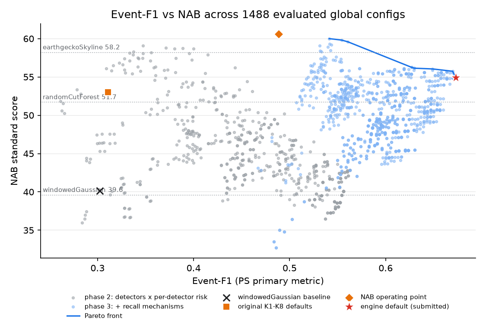

# Sentinel: adaptive streaming anomaly detection (Hackathon Challenge 2)

Sentinel is a lightweight, strictly causal anomaly detector for univariate time series. It reads one
`(timestamp, value)` point at a time and returns, for every point, a `score` in [0, 1], a `NORMAL`/`ANOMALOUS`
`label`, an `is_event_start` flag and a structured `evidence` dict that explains each flag.

The detector is an ensemble of two O(1) statistical detectors (a robust z-score and a long-horizon lagged
residual, after the ICLR 2026 "one-liner" baselines). Each has its own Extreme-Value-Theory threshold (SPOT, with a
per-detector risk level), plus a spatial-extreme flag and an event manager that turns point alarms into
well-placed events.

On the full NAB corpus (58 files, 116 anomaly windows) the engine default reaches **event-F1 0.691** (precision
0.731, recall 0.655, 28 false-positive events). The windowedGaussian baseline gets 0.302. A 16-setting
leave-one-category-out selection scored **0.664 pooled / 0.590 mean**; this is a grid-selection result, not a
held-out score for the fixed default. The engine runs at about **2.9 µs per point** on one core. A second global
operating point reaches a **NAB standard score of 60.58**, above earthgecko Skyline (58.2) and Random Cut Forest
(51.7).

- How it works, stage by stage, with a worked example: **[explain.md](docs/explain.md)**
- Slides: **[presentation.pdf](presentation.pdf)** · [Markdown outline](docs/presentation.md) · regenerate with `python -m eval.build_presentation_pdf` (requires ReportLab)
- Design decisions: [architecture_decisions.md](docs/architecture_decisions.md)
- Background (anomaly types, EVT, NAB scoring): [domain_knowledge.md](docs/domain_knowledge.md)
- Configuration tuning, current default, and previous setting: [configuration_tuning.md](docs/configuration_tuning.md)
- Result reports: [benchmark leaderboard](docs/results/benchmark_leaderboard.md),
  [detector ablation](docs/results/detector_ablation_results.md),
  [model performance](docs/results/model_performance_comparison.md),
  [inference runtime](docs/results/inference_runtime_comparison.md),
  [detection delay](docs/results/detection_delay_comparison.md),
  [missed anomalies](docs/results/missed_anomaly_analysis.md),
  [event-F1 tuning](docs/results/hyperparameter_tuning.md), and
  [joint objective tuning](docs/results/joint_objective_tuning.md)

## Repository layout

```
sentinel/            detection engine (NumPy + stdlib in the hot path)
  pipeline.py          Sentinel class: update(t, x) -> Result; run_series(df)
  config.py            DEFAULT_CONFIG (engine default) and ORIGINAL_DEFAULT_CONFIG (first version)
  detectors.py         D1 RobustZ, D2 LastW, D3 LaggedResidual, D4 VarRatio, D5 Seasonal, D6 CUSUM, D7 IsolationForest
  spot.py              SPOT / DSPOT (peaks-over-threshold, GPD by method of moments)
  fusion.py            MAX / k-of-n vote fusion
  recall.py            spatial-extreme flag, score smoother
  events.py            debounce, merge gap, cooldown, rebaseline
  explain.py           evidence dict + text
  validate.py          input sanitising (NaN/inf, bad types, duplicate/backward/tz-mixed timestamps)
  state.py pool.py     checkpoint save/load, SentinelPool for many streams
  __main__.py          CLI: python -m sentinel
eval/                evaluation and experiments
  data.py scorer.py    corpus loader, event scorer (AGENTS.md §5)
  nab_score.py         official NAB score through data/NAB/nab/sweeper.py
  baselines.py         null, random, windowedGaussian
  run.py               score one detector/config on the corpus -> results/runs/*.json
  predict.py           predictions for any folder of CSVs (hidden test windows)
  tune.py ablation.py  LOCO grid search, ablation
  benchmark.py         µs/point
  miss_analysis.py     why windows are missed
  nab_runtime.py nab_compare.py   NAB's own detectors: measured runtime, event-F1 from their stored scores
  leaderboard.py figures.py       docs/results/benchmark_leaderboard.md, results/figures/*.png
app/dashboard.py     Streamlit replay demo
tests/               pytest suite (114 tests)
results/             runs/*.json (one per experiment), best_*config.json, figures/
docs/               project documentation (design, background, tuning, presentation)
  results/           generated Markdown result reports
logs/  TASKS.md  AGENTS.md  CLAUDE.md
data/                local only, never committed (NAB clone and/or starter pack)
```

## Requirements

- Python **≥ 3.10** (the code uses `dataclass(slots=True)`). The system `python3` on macOS is 3.9, so create the venv
  with 3.11 (`uv venv -p 3.11 .venv` or `python3.11 -m venv .venv`). The numbers below come from Python 3.11.15.
- `requirements.txt`: numpy, pandas, scipy, scikit-learn, streamlit, plotly, matplotlib, pytest. The engine itself
  needs only numpy and pandas (`pip install -e .` installs numpy, pandas, scipy and scikit-learn).
- Optional, only for `eval.nab_runtime` (timing NAB's own detectors): `statsmodels` (earthgecko Skyline). NAB's Numenta,
  HTM Java, ARTime, Random Cut Forest and Twitter ADVec detectors need Python 2, Java, Julia, AWS or R and are reported
  as not runnable.
- macOS or Linux, single core is enough (all timings are single-process), about 1 GB free disk (data/NAB is 350 MB).

## Setup

```bash
git clone https://github.com/Lokesh-Kudipudi/Hack.git hack && cd hack
uv venv -p 3.11 .venv            # or: python3.11 -m venv .venv
source .venv/bin/activate
pip install -r requirements.txt  # with uv: uv pip install -r requirements.txt
pip install -e .                 # optional: installs the `sentinel` package and command
git clone --depth 1 https://github.com/numenta/NAB data/NAB    # corpus, labels and NAB scorer (once per machine)
python -m pytest -q              # 114 passed
```

**Data location.** The loader finds every `*.csv` with `timestamp,value` columns under a root folder. A file's
category is the name of its parent folder, and its key `<category>/<file>.csv` matches `combined_windows.json`.
All of these layouts work:

```
data/NAB/data/<category>/<file>.csv                 git clone of numenta/NAB (default root when present)
data/<category>/<category>/<file>.csv               organiser starter pack, zip extracted into data/
<any folder>/<category>/<file>.csv
```

- `SENTINEL_DATA=/path/to/root` overrides the corpus root. The default is `data/NAB` if it exists, else `data/`.
- `SENTINEL_WINDOWS=/path/to/combined_windows.json` overrides the labels. The default is `<root>/labels/`, then the
  first `combined_windows.json` under the root, then `data/NAB/labels/`.
- Nothing under `data/` is ever committed (`.gitignore`).

## Usage

**Python API**

```python
from sentinel import Sentinel
from eval.data import load_series

df = load_series("data/NAB/data/realKnownCause/nyc_taxi.csv")
s = Sentinel(n_total=len(df))              # engine default; n_total sets probation = min(0.15 n, 750)
for t, x in zip(df.timestamp.tolist(), df.value.tolist()):
    r = s.update(t, x)                     # Result(timestamp, value, score, label, is_event_start, evidence, ...)
    if r.is_event_start:
        print(r.timestamp, r.score, r.evidence["text"])
```

`config=` takes overrides. Nested dicts merge, an empty dict replaces, and dotted keys set nested values, so
`Sentinel(config=json.load(open("results/best_nab_config.json")))` gives the NAB operating point. Without `n_total`
(a live stream), probation is 300 points. `s.save("ckpt.json")` and `Sentinel.load("ckpt.json")` resume a stream
with identical output.

**CLI**

```bash
python -m sentinel -i data/NAB/data/realKnownCause/nyc_taxi.csv --anomalies-only           # JSONL to stdout
python -m sentinel -i series.csv -o out.csv --format csv -c results/best_nab_config.json
cat stream.jsonl | python -m sentinel > flagged.jsonl                                      # live stream, stdin
python -m sentinel -i multi.csv --stream-col stream_id                                     # many streams
```

**Predictions for a folder of CSVs** (e.g. hidden test windows)

```bash
python -m eval.predict --input data/starter --out outputs/starter-predictions [--windows auto] [--combined] [--config default]
```

This writes `<category>/<file>.csv` per point (score, label, is_event_start, evidence type, text and JSON),
`events.csv` with one row per event, and `summary.json` (runtime, plus metrics when `--windows` is given). The
default config is `results/best_config.json`, which matches the engine default (`w=8`, `h=256`, spatial margin 5.75%).

**Saved predictions for the current default on all 58 NAB files:** [combined per-point CSV](outputs/predictions/predictions.csv),
[per-file CSVs](outputs/predictions/), [detected events](outputs/predictions/events.csv), and
[run summary](outputs/predictions/summary.json). They cover 365,558 points and reproduce event-F1 **0.691**
(precision **0.731**, recall **0.655**). These are the tracked default predictions; raw NAB input data stays local.
To regenerate them, run:

```bash
python -m eval.predict --input data/NAB/data --out outputs/predictions \
  --windows data/NAB/labels/combined_windows.json --combined \
  --config results/best_config.json
```

**Dashboard**

```bash
streamlit run app/dashboard.py
```

Pick a series and an operating point, then press Replay. The page shows the value with its expected band and ground
truth windows, events with evidence cards, per-detector scores and a running event-F1.

## Experiment strategy

1. **Baselines.** null, random and windowedGaussian, scored with our event scorer and with the official NAB scorer
   (which reproduces NAB's published 0.0 / 39.65 / 70.10 for null / windowedGaussian / Numenta).
2. **Detectors.** Six causal one-liner detectors (ICLR 2026 multi-horizon idea), each tested alone and removed
   (`docs/results/detector_ablation_results.md`).
3. **SPOT thresholds.** Peaks-over-threshold with a GPD per detector instead of fixed z cut-offs. This took a static
   robust z-score from F1 0.040 (4,519 FPs) to 0.376.
4. **Event lifecycle.** Debounce, merge gap, cooldown and rebaseline, because event-F1 counts only the first start
   per window.
5. **Per-detector risk** (ADR-009). The clean residual detectors need a looser q. This enabled RobustZ +
   LaggedResidual and gave 0.563.
6. **Recall mechanisms** (ADR-010), from the miss analysis: spatial-extreme flag, cooldown proportional to probation,
   debounce 3 with a 2× extreme bypass. Together they gave 0.640 → 0.673. A later lag/margin sweep raised the default to 0.691.

Rules that held throughout:
- **Global configs only.** There is no per-file tuning on labels.
- **Leave-one-category-out (LOCO):** tune on 6 categories, test on the 7th, rotate. The current lag/margin setting
  had the best full-corpus event-F1 among 16 joint candidates. That grid's LOCO selection scored 0.664 pooled /
  0.590 mean; it is not a held-out score for the fixed default.
- **Two operating points.** Event-F1 and NAB favour different settings (`results/figures/pareto_f1_nab.png`).
- **Miss analysis** classifies every missed window as suppressed, seen only by another detector, or weak.

About 3,300 configs were evaluated over six grids: `default` 648, `perdet` 432, `subsets` 720, `joint` 576,
`recall` 480, `recall2` 432.

## Reproducibility

Run in this order from the repo root with the venv active. Every `eval.run` call writes
`results/runs/<timestamp>_<detector>_<tag>.json`; `--no-save` only prints. The tags below are the ones the
leaderboard and figures look up.

```bash
python -m pytest -q                                                                         # 114 passed, ~5 s
python -m eval.nab_score --nab-results null windowedGaussian numenta                       # 0.00 / 39.65 / 70.10 (= published)
python -m eval.run --detector null --tag baseline
python -m eval.run --detector random --tag baseline
python -m eval.run --detector windowed_gaussian --config '{"threshold": 1.0}' --tag "baseline thr=1.0"
python -c "import json; from sentinel.config import ORIGINAL_DEFAULT_CONFIG as c; print(json.dumps(c))" > /tmp/orig.json
python -m eval.run --detector sentinel --config /tmp/orig.json --tag "likhit default"
python -m eval.run --detector sentinel --tag "engine default (final)"
python -m eval.run --detector sentinel --config results/best_nab_config.json --tag "NAB operating point (final)"
# Historical 432-setting search; docs/results/hyperparameter_tuning.md records the former default.
# The current best_config.json is from the later lag/margin sweep in docs/configuration_tuning.md.
python -m eval.ablation --tag final                               # docs/results/detector_ablation_results.md, figures/ablation.png (~3 min)
python -m eval.miss_analysis                                      # docs/results/missed_anomaly_analysis.md, figures/miss_analysis.png
python -m eval.benchmark                                          # µs/point, all detectors
python -m eval.nab_runtime                                        # NAB detectors timed (needs statsmodels; ~2 min)
python -m eval.nab_compare                                        # docs/results/model_performance_comparison.md, figures/model_comparison.png
python -m eval.predict --input data --windows auto -q             # must print event-F1=0.691
python -m eval.leaderboard                                        # docs/results/benchmark_leaderboard.md
python -m eval.figures                                            # results/figures/*.png
```

The other tune grids are `default`, `perdet`, `subsets`, `recall` and `joint`. `joint` is run with
`--grid joint --objective joint --nab-min 52` and writes `docs/results/joint_objective_tuning.md` / `best_joint_config.json`. The `phase 2` leaderboard
row ("tuned for event-F1 (LOCO, RobustZ+LaggedResidual)") is a stored run. It is reproduced by `eval.ablation`'s
"per-detector SPOT risk" row (0.563).

**Expected values**

| Quantity | Value | Tolerance |
|---|---|---|
| Engine default event-F1 / P / R / TP / FP / FN | 0.691 / 0.731 / 0.655 / 76 / 28 / 40 | exact (deterministic) |
| NAB standard (engine default / NAB point / original defaults) | 58.80 / 60.58 / 53.00 | ±0.01 |
| windowedGaussian (thr 1.0) event-F1 / NAB (our per-point scorer) | 0.302 / 40.13 | exact |
| Joint lag/margin grid LOCO pooled / mean F1 | 0.664 / 0.590 | grid-selection result |
| Sentinel µs/point (`eval.benchmark`) | about 2.8 | hardware-dependent |

**Determinism.** The engine has no randomness, except the IsolationForest stretch detector, which uses a fixed seed
42. The random baseline is seeded per file. Detection results are bit-identical across runs and machines with the
same numpy/pandas. Only the µs/point and points/s figures depend on hardware and load. Those were measured on an
Apple-silicon (arm64) Mac, Python 3.11.15, single process, without other jobs running. Expect a full-corpus
`eval.run` to take about 5 s for Sentinel and about 20 s for windowedGaussian.

## Results

Full NAB corpus, event metrics per AGENTS.md §5 (probation excluded, 116 windows). The NAB column is the official
standard-profile score of the per-point `score`. µs/pt comes from `eval.benchmark` for the engine default and
baselines, and from `eval.run` otherwise.

| Detector | Event-F1 | P | R | TP | FP | FN | NAB std | µs/pt |
|---|---|---|---|---|---|---|---|---|
| windowedGaussian (NAB baseline, thr 1.0) | 0.302 | 0.211 | 0.534 | 62 | 232 | 54 | 40.1 | 49.3 |
| Sentinel, original K1–K8 defaults | 0.311 | 0.197 | 0.733 | 85 | 346 | 31 | 53.0 | 6.4 |
| Sentinel, phase 2 (per-detector risk, ADR-009) | 0.563 | 0.675 | 0.483 | 56 | 27 | 60 | 42.8 | 2.4 |
| **Sentinel, engine default** | **0.691** | **0.731** | **0.655** | **76** | **28** | **40** | **58.8** | **2.8** |
| Sentinel, NAB operating point | 0.489 | 0.366 | **0.733** | 85 | 147 | **31** | **60.6** | 5.1 |

- **Engine default:** RobustZ + LaggedResidual, MAX fusion, SPOT q = 1e-6 (1e-5 for LaggedResidual), spatial-extreme
  flag (5.75% of the range), LaggedResidual `w=8, h=256`, debounce 3, extreme bypass 2.0×, cooldown 0.5 × probation.
- **NAB operating point** (`results/best_nab_config.json`): adds Seasonal (threshold 15) and two-sided VarRatio
  (threshold 3), a 2-detector agreement bypass, and LaggedResidual risk 1e-4.
- **Joint lag/margin grid LOCO selection:** pooled F1 0.664 / mean 0.590. This validates the selection
  procedure, not the one fixed default. artificialNoAnomaly has no windows and 0 FPs.

**Comparison with published NAB detectors** ([docs/results/model_performance_comparison.md](docs/results/model_performance_comparison.md)). Event
metrics for published detectors are computed by our scorer from NAB's stored per-point scores at NAB's own
standard-profile threshold. µs/point was measured on the same machine with NAB's own implementations
([docs/results/inference_runtime_comparison.md](docs/results/inference_runtime_comparison.md): first 4,032 points of 6 files).

| Model | Event-F1 | P | R | FP | NAB std | µs/point |
|---|---|---|---|---|---|---|
| CAD OSE | 0.676 | 0.590 | 0.793 | 64 | 69.9 | 231.1 |
| **Sentinel, engine default** | **0.691** | **0.731** | **0.655** | **28** | **58.8** | **2.7** |
| Numenta HTM | 0.527 | 0.387 | 0.828 | 152 | 70.1 | not runnable (nupic, Python 2) |
| Sentinel, NAB operating point | 0.489 | 0.366 | 0.733 | 147 | 60.6 | 5.1 |
| ARTime | 0.483 | 0.328 | 0.914 | 217 | 74.9 | not runnable (Julia) |
| Relative Entropy | 0.452 | 0.341 | 0.672 | 151 | 54.6 | 585.3 |
| earthgecko Skyline | 0.372 | 0.247 | 0.750 | 265 | 58.2 | 316.9 |
| KNN CAD | 0.350 | 0.225 | 0.784 | 313 | 58.0 | 773.7 |
| Windowed Gaussian (NAB) | 0.283 | 0.183 | 0.629 | 326 | 39.6 | 57.8 |

Caveats:
- The published detectors' thresholds were tuned for the NAB score, and each threshold crossing counts as one event
  (no merging or cooldown). Their event-F1 is therefore a lower bound on what they could reach.
- Sentinel was tuned on this same public corpus. The lag/margin grid LOCO selection F1 is 0.664 pooled;
  it is not a held-out score for the fixed default.
- Runtime depends on hardware and load; the new default measured 2.86 µs/point on the full corpus.
- The windowedGaussian row uses NAB's implementation and threshold. Our re-implementation at threshold 1.0 (first
  table) gets 0.302.

Figures: [published_comparison.png](results/figures/published_comparison.png),
[model_comparison.png](results/figures/model_comparison.png),
[ablation_progression.png](results/figures/ablation_progression.png),
[pareto_f1_nab.png](results/figures/pareto_f1_nab.png), [per_category_f1.png](results/figures/per_category_f1.png),
[miss_analysis.png](results/figures/miss_analysis.png), [example_nyc_taxi.png](results/figures/example_nyc_taxi.png).



## Known limitations

- Tuning and evaluation use one public corpus. LOCO limits but does not remove optimism.
- The new default misses 40 windows. The refreshed [miss analysis](docs/results/missed_anomaly_analysis.md) classifies
  21 as alarms from other detectors, 11 as weak signal, and 8 as suppressed events.
- Streams shorter than 7 points get probation 0 and are never flagged. `seasonal.auto_period` has no effect.
  Rebaseline is count-based, not CUSUM-confirmed.

See [presentation.md](docs/presentation.md) slide 10 and [explain.md](docs/explain.md) for details.
