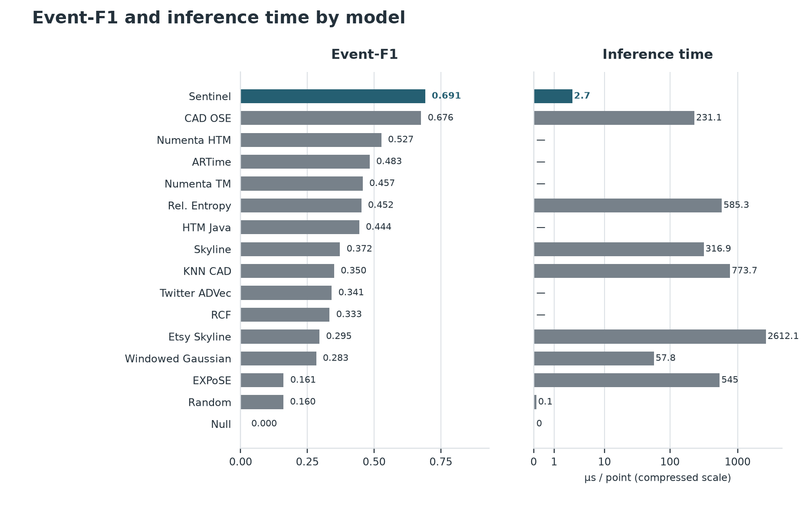
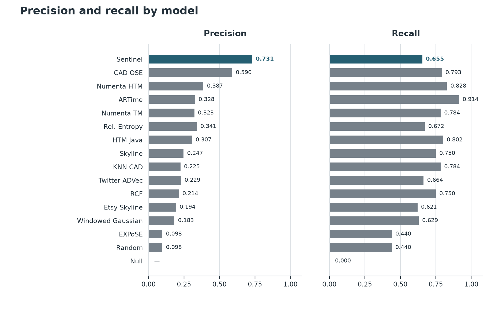
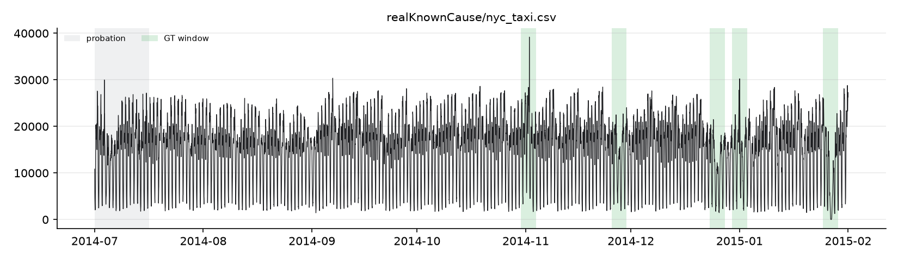

# Sentinel — 10-slide presentation outline

Keep the slides simple: white background, dark text, one muted accent colour, and a plain sans-serif font. Show only Sentinel's current default when discussing our model. Compare it with other models where useful.

---

## Slide 1 — Sentinel

**Team April 28** · Lokesh K · Likhit G
**Track:** Challenge 2 — Adaptive Time-Series Anomaly Detection

**One-line solution:** Sentinel flags unusual events in a live stream using two simple statistical checks, adaptive thresholds, and one clear alert per event.

- Event-F1 **0.691** on the full NAB corpus.
- **2.8 µs** per point, with an explanation for each alert.

---

## Slide 2 — Problem and motivation

- A time series is a sequence of readings, such as CPU usage, traffic, or sales.
- We must flag unusual behaviour **as each reading arrives**, using only what came before it.
- Missed incidents matter; too many false alerts waste people's attention.
- Each result includes a score, a `NORMAL` or `ANOMALOUS` label, and a short explanation.

---

## Slide 3 — Data and preparation

| NAB category | Files | Anomaly windows |
|---|---:|---:|
| Artificial | 11 | 6 |
| AWS CloudWatch | 17 | 30 |
| Ad Exchange | 6 | 14 |
| Known Cause | 7 | 19 |
| Traffic | 7 | 14 |
| Tweets | 10 | 33 |
| **Total** | **58** | **116** |

- **365,558 readings** in total. Tweet files contain the most anomaly windows (33); the artificial no-anomaly files contain none.
- We process each file in its original order. A few files have repeated or out-of-order timestamps.
- The first 15% of each file, up to 750 readings, is a learning period. No alarms are raised or scored there.

---

## Slide 4 — System design

```text
Reading (time, value)
          ↓
Check and clean input
          ↓
Learning period complete?
          ↓
RobustZ + LaggedResidual → adaptive thresholds
          ↓
New-high / new-low check
          ↓
Event manager → score, label, explanation
```

- Every decision uses the current and earlier readings only.
- The event manager confirms unusual readings, joins nearby alarms, and spaces out repeated alerts.

---

## Slide 5 — Core algorithm

| Part | Simple explanation |
|---|---|
| **RobustZ** | Checks how far the current value is from its usual level, while allowing for normal variation. |
| **LaggedResidual** | Compares the current value with the **average of 8 readings from roughly 256 points earlier**. |
| **Adaptive thresholds** | Each detector sets its own alarm level from the high scores seen in the learning period and updates it as normal data arrives. |
| **Spatial-extreme check** | Flags a new high or low beyond the range seen so far. |

- RobustZ starts with the **median** of the learning-period readings. The typical spread is measured separately, so a value is not called unusual merely because it is above the median.
- LaggedResidual helps detect changes that continue for a while.

---

## Slide 6 — Experiment history and tuning

**We measured each change before choosing the current default.**

1. Compared simple baselines and detector signals on NAB.
2. Searched detector combinations and tested lag and window lengths.
3. Tested the spatial-extreme margin and event grouping rules.
4. Selected one global default: **RobustZ + LaggedResidual**, an **8-point** older average, a **256-point** lag, and a **5.75%** spatial margin.

- Settings are global; we do not choose a different configuration for each file using its labels.
- During tuning, we rotated the category left out of selection to check whether settings transferred to other data types.

---

## Slide 7 — Evaluation method

- **True positive:** an alert starts inside a labelled anomaly window.
- **False positive:** an alert starts outside every labelled window.
- **False negative:** a labelled window has no alert start.
- On all 58 files: **76 true positives**, **28 false positives**, **40 false negatives**.

| Metric | Current default |
|---|---:|
| Precision | **0.731** |
| Recall | **0.655** |
| Event-F1 | **0.691** |
| Official NAB score | **58.80** |

---

## Slide 8 — Comparison with other models

| Model | Event-F1 | False events | Same-stream time per point |
|---|---:|---:|---:|
| **Sentinel current default** | **0.691** | **28** | **2.7 µs** |
| CAD OSE | 0.676 | 64 | 231 µs |
| Numenta HTM | 0.527 | 152 | — |
| Windowed Gaussian (NAB) | 0.283 | 326 | 57.8 µs |





The charts include all models with recorded event metrics. A dash means no local runtime or undefined precision. The time axis is compressed, but its value labels are in actual µs per point. Published models' event results use NAB's stored scores and thresholds; measured runtimes use the same machine.

---

## Slide 9 — Example alert and evidence



**Example alert:** NYC taxi readings on 1 November 2014 rose to **25,115**, compared with an older-window average of about **2,602**. LaggedResidual flagged the difference.

- Green bands: labelled anomaly windows.
- Red dots: Sentinel event starts.
- On this file, the current default finds **4 of 5** windows with **0 false events**.

---

## Slide 10 — Limits and next steps

- **40 of 116** labelled windows are still missed. Changes in daily patterns can be hard to spot when values remain inside the usual range.
- The default was selected and measured on public NAB data. Performance on hidden data is unknown.
- Future work: improve detection of pattern changes while keeping false alerts and runtime low.

**Conclusion:** A small, causal detector can produce clear alerts and reach **0.691 event-F1** at about **2.8 µs per point**.
