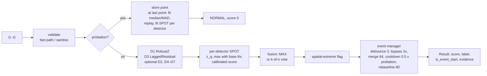
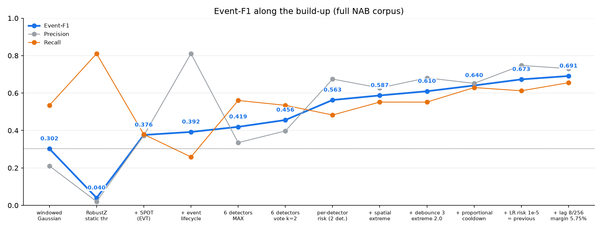
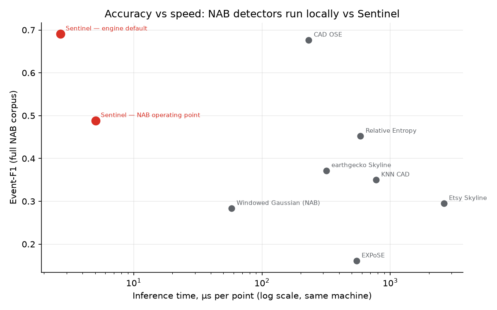
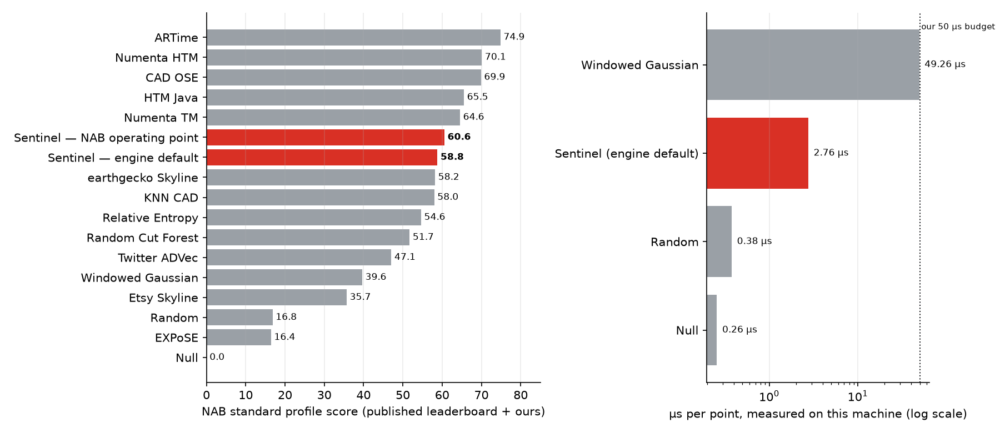
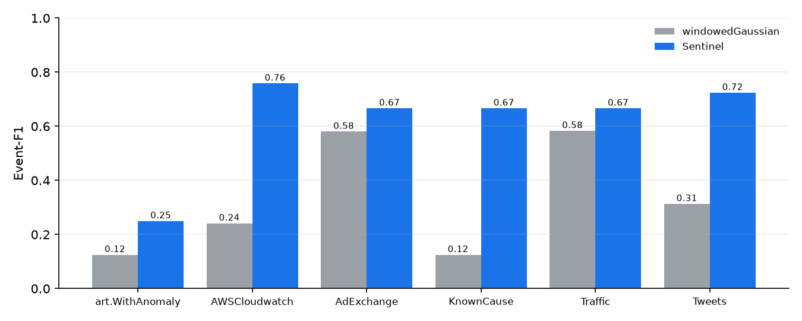
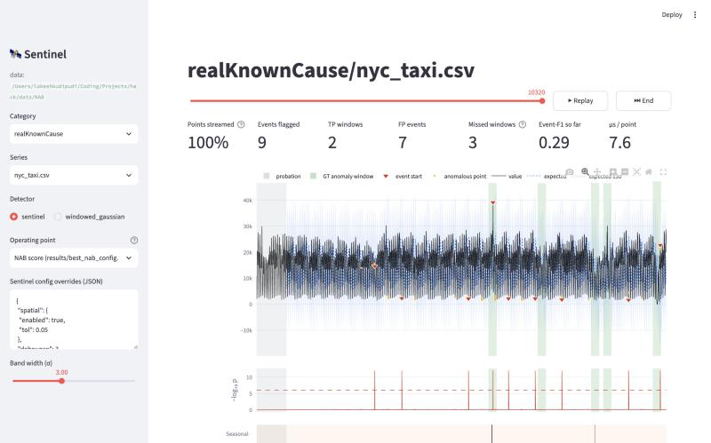

# Sentinel: adaptive streaming anomaly detection

Ten slides. Each has bullet content and speaker notes. Figures are in `results/figures/`. Every number was
re-measured on the final code (commands in [README.md](README.md#reproducibility)).

---

## Slide 1 — Sentinel

- **Team:** April 28
- **Members:** Lokesh K, Likhit G
- **Track:** Challenge 2, Adaptive Time-Series Anomaly Detection
- **One line:** a strictly causal, about 2.8 µs/point streaming detector. Two statistical one-liners, each with its own
  Extreme-Value-Theory threshold, plus a spatial-extreme flag and an event lifecycle. Every alarm explains itself.
- **Headline (NAB, 58 files, 116 windows):** event-F1 **0.691** (P 0.731, R 0.655, 28 false alarms) vs 0.302 for the
  windowedGaussian baseline. The 16-setting lag/margin LOCO selection scores **0.664 pooled / 0.590 mean**. NAB operating point **60.58**.

> Speaker notes: We built Sentinel for the problem as posed: points arrive one at a time, labels are hidden, and
> both accuracy and runtime are scored. The headline is that a small, explainable statistical engine exceeds the
> published CAD OSE event-F1 of 0.676 on this corpus. It has fewer than half of CAD OSE's false alarms (28 vs 64)
> and runs about about 86× faster on the same machine.

---

## Slide 2 — Problem understanding

- **Task:** for every point of a univariate stream, output a score in [0, 1], a label and evidence, with no
  look-ahead. Scored on event-F1 (primary), precision, recall, detection delay and runtime.
- **Practical motivation:** infrastructure and business metrics (CPU, latency, ad spend, traffic, tweet volume) are
  watched by on-call people. Each alert costs attention.
- **What matters in the real world:**
  - **Streaming:** a decision now, from the past only. A detector that normalises by the whole file cannot be
    deployed.
  - **Alert fatigue:** one alert per incident, not one per point. Event-F1 counts every extra start outside a window
    as a false positive.
  - **Interpretability:** "value 39,197 is a new high, above the range seen so far" can be acted on. A bare score of
    0.93 cannot.
  - **Latency and cost:** thousands of streams per machine need O(1) work per point.
- **Constraint we designed around:** test windows are hidden, so we use global hyperparameters only, never
  per-file tuning.

> Speaker notes: Event-F1 changes the design. An event matters more than a point, so the event lifecycle (debounce,
> cooldown, merge) is as important as the detectors. The ICLR 2026 "one-liners" paper showed that time-series
> foundation models behave like moving-variance and last-value baselines. That is why we build cheap, adaptive
> versions of those baselines instead of training a deep model.

---

## Slide 3 — Dataset, EDA, preprocessing

| Category | Files | Windows | Points |
|---|---|---|---|
| artificialNoAnomaly | 5 | 0 | 20,160 |
| artificialWithAnomaly | 6 | 6 | 24,192 |
| realAWSCloudwatch | 17 | 30 | 67,740 |
| realAdExchange | 6 | 14 | 9,610 |
| realKnownCause | 7 | 19 | 69,561 |
| realTraffic | 7 | 14 | 15,664 |
| realTweets | 10 | 33 | 158,631 |
| **Total** | **58** | **116** | **365,558** |

- **Sampling:** 48 files at 5 min, 7 hourly, 2 at 10 min, 1 at 30 min.
- **Windows** (`combined_windows.json`): centred on the labelled anomaly, about 10% of each file in total. Widths are
  29–1,499 points (median 212) and 2.3–535 h (median 33 h).
- **Irregular time:** 8 files have duplicate timestamps. machine_temperature_system_failure has a backward timestamp.
  We stream in file order, as NAB does.
- **No-anomaly category:** artificialNoAnomaly has 0 windows. Any event there is a pure false positive (the engine
  default makes 0).
- **Preprocessing workflow:**
  - stream each file in file order through a fresh detector
  - first min(floor(0.15n), 750) points are probation: learn only, never flag, not scored
  - input sanitising: NaN/None → last value, ±inf clipped, bad or tz-mixed timestamps repaired
  - **no normalisation with future data**: the scale is the probation MAD, updated only causally

> Speaker notes: Two EDA facts shaped the method. First, windows are wide and centred on the label. A detection at
> 50% of the window is a detection at the anomaly itself, so "delay" is not the main lever: recall is. Second,
> category sizes are very uneven. Tweets have 33 windows, artificialWithAnomaly only 6. That is why we report
> micro-F1 and validate per category.

---

## Slide 4 — System design

- **Per point:** O(1) work with running sums over fixed-size deques. NumPy + stdlib only in the hot path.
- **Interfaces:**
  - `Sentinel.update(t, x) -> Result`
  - `run_series(df)`
  - `python -m sentinel` CLI (JSONL or CSV, stdin streaming, multi-stream `SentinelPool`)
  - `eval.predict` for a folder of CSVs
  - `save()` / `load()` checkpoints that resume with identical output
- **Evaluation side:** event scorer (AGENTS.md §5), official NAB sweeper wrapper, LOCO tuner, ablation, benchmark,
  miss analysis, Streamlit replay.

> Speaker notes: The pipeline is the code path of `Sentinel.update()`; explain.md walks through it stage by stage.
> Probation is the only place with batch work. The rest is constant-time per point, and the whole update costs
> about 2.8 µs including validation.

---

## Slide 5 — Core algorithm and model choices

- **Why statistics + EVT, not deep models:**
  - no labels at test time
  - runtime is scored
  - NAB is led by simple adaptive methods
  - the ICLR 2026 result says TSFMs ≈ Var-w / Last-w one-liners
  - every alarm must be explainable
- **Detector roles** (default = D1 + D3):
  - **D1 RobustZ** |x − median| / (1.4826·MAD): spikes. Threshold floor 6σ.
  - **D3 LaggedResidual** |x − mean of the 16 values that ended 64 steps ago| / scale: sequence anomalies and shifts.
    The long-horizon reference is not contaminated by the anomaly (ICLR §6.1).
  - Optional (used in the NAB point): D4 VarRatio (two-sided, catches flatlines) and D5 Seasonal (hour-of-day
    profile). Also available: D2 LastW, D6 CUSUM, D7 random-cut isolation.
- **Thresholds = SPOT per detector:**
  - fit a GPD to the top 2% of probation scores (method of moments)
  - z_q = t + σ/γ·((qn/N_t)^−γ − 1)
  - alarm when raw > max(z_q, base threshold)
  - the tail fit updates online, but never with alarms
- **Per-detector risk** (ADR-009): q = 1e-6 globally, 1e-5 for LaggedResidual. Clean detectors need a looser q to fire
  at all. With RobustZ + LaggedResidual it lifts event-F1 from 0.438 to 0.563.
- **Spatial-extreme flag** (ADR-010): a value beyond the running [min, max] by more than 5.75% of the range is an
  immediate event. It is the single largest recall gain: the earlier 5% setting fell from 0.673 to 0.428 when the flag was removed.
- **Event lifecycle:**
  - debounce 3 consecutive points, or bypass at 2× threshold
  - merge gaps < 64 points
  - cooldown 0.5 × probation (375 points on long files)
  - rebaseline after 80 anomalous points

> Speaker notes: The threshold design is the core of the "approach" score. SPOT replaces hand-set z cut-offs with a
> per-series tail model. The per-detector risk level is our main change to plain SPOT. The base threshold acts as a
> floor, so a very light probation tail does not cause alarms at 3σ.

---

## Slide 6 — Experiment history and tuning

| Step | Event-F1 | What changed |
|---|---|---|
| windowedGaussian baseline (thr 1.0) | 0.302 | NAB's baseline, re-implemented |
| Original K1–K8 engine | 0.311 | 6 detectors, SPOT q = 1e-4, 2-of-n vote, debounce 2, cooldown 200. High recall (0.733), 346 FPs |
| Global LOCO grid on the 6-detector engine | 0.481 | 648 configs: q = 1e-6, thresholds × 1.5, cooldown 600, merge gap 64 (held-out pooled 0.412) |
| Per-detector SPOT risk + detector subsets | 0.563 | 432 + 720 configs: RobustZ + LaggedResidual, q_LR = 1e-4 (held-out 0.510) |
| Recall mechanisms | 0.640 | 480 configs: spatial flag, debounce 3, bypass 2×, cooldown 0.5 × probation (held-out 0.623) |
| Re-opened risk with the recall mechanisms on | 0.673 | 432 configs: previous default, q_LR = 1e-5 (LOCO pooled 0.654, mean 0.593) |
| Joint lag/margin sweep | **0.691** | Current default: w=8, h=256, margin 5.75%; 16-setting LOCO pooled 0.664 / mean 0.590 |

- **Search strategy:**
  - global configs only, as full grids (648 / 432 / 720 / 576 / 480 / 432, about 3,300 configs in total)
  - every config run on the whole corpus in parallel
  - LOCO selection: the best config on 6 categories is scored on the 7th
  - ties on F1 broken by the smaller median delay
  - a joint objective (max F1 subject to NAB ≥ floor; the floor uses the full corpus) for a single compromise config
- **Ablation build-up** (`results/ablation.md`):
  - static robust z 0.040 (4,519 FPs) → + SPOT 0.376 → + events 0.392 → 6 detectors MAX 0.419 / vote 0.456
  - → per-detector risk 0.563 → + spatial 0.587 → + debounce 3 / bypass 2× 0.610 → + cooldown 0.640 → previous default 0.673 → current default 0.691

> Speaker notes: Each step came from a measured diagnosis, not a guess. The ablation showed that LastW and
> LaggedResidual added nothing under one global risk level, which led to per-detector q. The miss analysis showed
> that 16 of the 60 misses (27%) were flagged but suppressed by cooldown or debounce. That led to the recall
> mechanisms. The Pareto plot shows that event-F1 and NAB pull in different directions, so we ship two operating
> points.

---

## Slide 7 — Evaluation methodology

- **Event-F1** (AGENTS.md §5), per file, with the probation prefix removed for both labels and predictions:
  - predicted event = a point with `is_event_start`
  - **TP** = a window containing ≥ 1 start (inclusive; duplicates ignored)
  - **FP** = a start outside every window
  - **FN** = a window with no start
  - micro P / R / F1 over the corpus; also per category and per file
  - windows are mapped to indices with first t ≥ start and last t ≤ end, so non-monotonic timestamps work
- **Detection delay:** first start − window start, in points, minutes and fraction of the window. Median 100 points,
  0.50 of the window = at the labelled point.
- **NAB score:** the official `sweeper.py` with corpus-wide threshold optimisation. Our wrapper reproduces the
  published null 0.0, windowedGaussian 39.65 and Numenta 70.10 exactly.
- **Runtime:** mean µs per `update()` over all 365,558 points, single process, data pre-loaded (no I/O). NAB's own
  detectors are timed through their `handleRecord()` on the same streams and machine.
- **Validation:**
  - lag/margin grid leave-one-category-out selection: pooled F1 **0.664**, mean 0.590; fixed default full-corpus F1 0.691
  - ablation: add and remove each component
  - pytest: 114 tests, including prefix-invariance (no look-ahead), determinism, fuzzing and checkpoint round-trips

| Category | Baseline F1 | Current default F1 (public corpus) | Previous grid LOCO F1 |
|---|---|---|---|
| artificialWithAnomaly | 0.125 | 0.250 | 0.250 |
| realAWSCloudwatch | 0.241 | 0.759 | 0.737 |
| realAdExchange | 0.581 | 0.667 | 0.741 |
| realKnownCause | 0.125 | 0.667 | 0.500 |
| realTraffic | 0.583 | 0.667 | 0.640 |
| realTweets | 0.313 | 0.724 | 0.689 |
| artificialNoAnomaly | 0 FP | 0 FP | 0 FP |

> Speaker notes: The last column shows the earlier 432-setting grid, not the current default. The new 16-setting
> grid scores 0.664 pooled under leave-one-category-out selection. Its chosen settings may differ by fold, so
> this does not directly estimate hidden-test F1 for the fixed 0.691 default.

---

## Slide 8 — Results

| Detector | Event-F1 | P | R | FP | FN | NAB std | µs/pt |
|---|---|---|---|---|---|---|---|
| windowedGaussian (baseline) | 0.302 | 0.211 | 0.534 | 232 | 54 | 40.1 | 48.6 |
| Sentinel, original defaults | 0.311 | 0.197 | 0.733 | 346 | 31 | 53.0 | 6.4 |
| **Sentinel, engine default** | **0.691** | **0.731** | **0.655** | **28** | **40** | **58.8** | **2.8** |
| Sentinel, NAB operating point | 0.489 | 0.366 | 0.733 | 147 | 31 | **60.6** | 5.1 |

**Against published NAB detectors**: their event metrics come from their stored scores at NAB's threshold.
µs/point is measured on our machine with NAB's code ([results/model_comparison.md](results/model_comparison.md)).

| Model | Event-F1 | FP | NAB std | µs/pt |
|---|---|---|---|---|
| CAD OSE | 0.676 | 64 | 69.9 | 231.1 |
| **Sentinel (default)** | **0.691** | **28** | **58.8** | **2.7** |
| Numenta HTM | 0.527 | 152 | 70.1 | not runnable (Py2) |
| ARTime | 0.483 | 217 | 74.9 | not runnable (Julia) |
| earthgecko Skyline | 0.372 | 265 | 58.2 | 316.9 |
| Windowed Gaussian (NAB) | 0.283 | 326 | 39.6 | 57.8 |

- **Caveats:**
  - Published detectors were tuned for NAB, and each threshold crossing counts as one event, so their event-F1 is a
    lower bound.
  - Sentinel was tuned on this corpus. Quote the 16-setting LOCO selection result 0.664 alongside the public-corpus 0.691, with its scope.

> Speaker notes: On the public corpus's primary metric we score above the best published detector and ahead of the rest,
> with the fewest false alarms of any detector with real recall. On NAB's own score the NAB operating point (60.6)
> ranks above earthgecko Skyline, KNN CAD, Relative Entropy and Random Cut Forest. HTM, ARTime and CAD OSE remain
> higher there.

---

## Slide 9 — Demo and sample predictions

- **Command:** `python -m eval.predict --input data/NAB/data --windows auto` reproduces event-F1 0.691.
  It writes per-point CSVs, `events.csv` (104 events: 43 spike, 61 sequence) and `summary.json`.
- **Real events** from `events.csv`:
  - **realKnownCause/nyc_taxi.csv, 2014-11-01 13:30 (TP, NYC Marathon window):** "Value 25115.00 is 4.1σ above
    lagged baseline 2602.00 (Sat 13:30) (sustained sequence divergence)."
  - **realKnownCause/machine_temperature_system_failure.csv, 2013-12-16 16:30 (TP):** "Value 21.74 is 17.7σ below
    lagged baseline 100.18 (Mon 16:30) (sustained sequence divergence)."
  - **artificialWithAnomaly/art_daily_jumpsup.csv, 2014-04-11 09:00 (TP):** "Value 127.88 is 25.5σ above
    expected 27.19 (Fri 09:00) (RobustZ detected isolated pulse or step jump). Corroborated by: SpatialExtreme."
- **Evidence JSON** (nyc_taxi):
  `{"type": "sequence", "expected": 2602.0, "observed": 25115.0, "deviation_sigma": 4.09, "fired": ["LaggedResidual"], "top_detector": "LaggedResidual", "threshold_ratio": 1.05, "confidence": 0.51}`
- **Dashboard** (`streamlit run app/dashboard.py`):
  - choose realKnownCause/nyc_taxi.csv and the "NAB score" operating point, then press Replay
  - the stream plays with its expected band and ground-truth windows
  - each event pops an evidence card; per-detector score lanes and a running event-F1 update live
  - screenshot below: NAB point on nyc_taxi gives 9 events, 2 of the 5 windows found (marathon, blizzard),
    7 false alarms, file event-F1 0.29. The current engine default gives 4 events, 4 TP, 0 FP (file F1 0.89)

> Speaker notes: The current default's longer lag finds four of the five NYC taxi windows. The older configuration's
> spatial-only marathon detection is traced in explain.md §4 as a historical example. The NAB operating point shown
> in the screenshot finds two windows and adds seven night-time false alarms.

---

## Slide 10 — Failure modes, limitations, future work

- **Known failure modes** (`results/miss_analysis.md`, 40 missed windows):
  - **Seen only by a detector outside the default** (21 misses; Seasonal alarms in 17 of them): the nyc_taxi holidays and blizzard, a flattened daily
    cycle (art_daily_flatmiddle), a missing daily jump (art_daily_nojump). Adding Seasonal to the default catches them but raises total false positives to 108
    (F1 0.541).
  - **Windows with no signal** (11): no detector alarms anywhere inside them.
  - **Suppressed** (8): flagged, but no event started (cooldown of an earlier event, or debounce).
  - **Small categories:** artificialWithAnomaly has only 6 windows. 5 are missed, and all 5 are
    seen only by Seasonal, so it scores 0.250.
  - **Short streams:** under 7 points means probation 0, never flagged. The 300-point fallback probation for live
    streams delays the first alarm.
- **Limitations:**
  - tuning and testing on one public corpus (LOCO reduces, but does not remove, optimism)
  - the F1-optimal and NAB-optimal configs differ (0.691 / 58.8 vs 0.489 / 60.6)
  - published detectors' event-F1 is a lower bound (no event post-processing)
  - rebaseline is count-based, not CUSUM-confirmed
  - `seasonal.auto_period` is not wired into scoring
- **Future work:**
  - a sequence / shape-memory channel (e.g. a discord or matrix-profile style distance) for pattern breaks inside
    the normal range
  - Seasonal with its own risk level and a weekly profile, tuned for precision
  - CAD-OSE ideas: contextual memory of recent patterns, rest period after an alarm
  - the organiser's submission format once the hidden test windows are released (`eval.predict` already writes
    per-point CSVs and an events table)
- **Conclusion:** two causal one-liners, per-detector EVT thresholds and a careful event lifecycle reach the best
  published event-F1 on NAB. The engine runs at about 2.8 µs per point, needs no training, and explains every alarm.

> Speaker notes: The remaining misses are honest limits of a value-based detector. When the anomaly is a change of
> shape inside the normal range, only a pattern model helps, and our Seasonal profile is too noisy as configured.
> That is the clearest next step.
